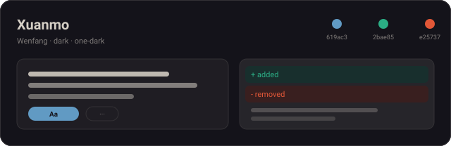
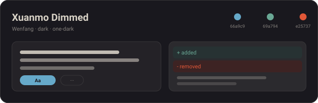
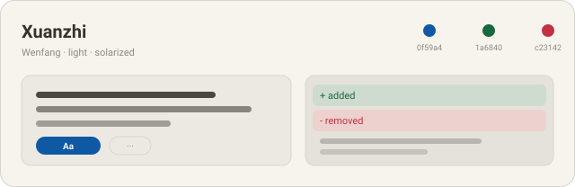
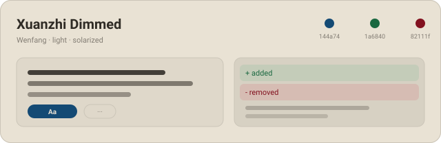
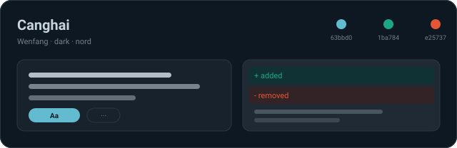
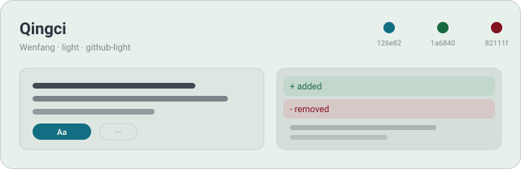

# Wenfang · 文房六色

[中文](README.zh.md) · English

Six palettes for coding agents — ink, paper, sea and porcelain, half dark and half light.
One design source generates every artifact: the Codex `codex-theme-v1:…` import strings
and the DeepSeek Harness theme plugin.

## Palettes

| | |
|:--:|:--:|
|  |  |
| **玄墨 · Xuanmo** — `dark`<br>Pine-soot ink ground, cinnabar accents. Built for long nights. | **玄墨 Dimmed · Xuanmo Dimmed** — `dark`<br>The same ink, one lamp lower. |
|  |  |
| **宣纸 · Xuanzhi** — `light`<br>Raw rice paper, blue-green wash. Daylight default. | **宣纸 Dimmed · Xuanzhi Dimmed** — `light`<br>Aged paper, deeper ink. Low glare. |
|  |  |
| **沧海 · Canghai** — `dark`<br>Deep-sea dusk, mineral teal. | **青瓷 · Qingci** — `light`<br>Moon-white celadon, blue-grey type. |

## Use with Codex

1. Copy the line for the variant you want from [`dist/codex/`](dist/codex/) — e.g.
   [`dist/codex/xuanmo.txt`](dist/codex/xuanmo.txt).
2. Codex → **Settings → Appearance** → choose **Dark** or **Light** to match the variant's
   column above → **Import**.
3. Paste the whole line, including the `codex-theme-v1:` prefix and with no code fence.
   `codeThemeId` is a built-in Codex syntax theme — a custom id greys out the Import button.

| Variant | Mode | File |
| --- | --- | --- |
| Xuanmo | Dark | [`dist/codex/xuanmo.txt`](dist/codex/xuanmo.txt) |
| Xuanmo Dimmed | Dark | [`dist/codex/xuanmo-dimmed.txt`](dist/codex/xuanmo-dimmed.txt) |
| Xuanzhi | Light | [`dist/codex/xuanzhi.txt`](dist/codex/xuanzhi.txt) |
| Xuanzhi Dimmed | Light | [`dist/codex/xuanzhi-dimmed.txt`](dist/codex/xuanzhi-dimmed.txt) |
| Canghai | Dark | [`dist/codex/canghai.txt`](dist/codex/canghai.txt) |
| Qingci | Light | [`dist/codex/qingci.txt`](dist/codex/qingci.txt) |

## Use with DeepSeek Harness

One package registers all six palettes (`wenfang-xuanmo` … `wenfang-qingci`):

```sh
dsh plugin --profile web add github:zhangcaiqian/wenfang-themes#path:/packages/dsh
# once published on npm:
# dsh plugin --profile web add wenfang-themes
```

Restart DSH (or reload the page), then **Settings → Plugin market → Themes →
registered palettes** and pick one. Switching is instant; the choice survives reloads and
falls back to the closest dark/light variant on first install.

## How it works

- [`themes/wenfang.json`](themes/wenfang.json) — the single source: five hand-tuned colors
  plus the Codex syntax id and contrast per variant.
- [`scripts/lib/codex.mjs`](scripts/lib/codex.mjs) — regenerates the six import strings;
  [`fixtures/codex/`](fixtures/codex/) pins them byte-for-byte.
- [`scripts/lib/dsh.mjs`](scripts/lib/dsh.mjs) — derives ~30 `--dsw-*` tokens per variant
  (surface ladder, borders, text ladder, diffs, selection, menus).
- [`scripts/lib/swatch.mjs`](scripts/lib/swatch.mjs) — the preview cards above.

```sh
node scripts/build.mjs        # regenerate everything
node scripts/check.mjs        # shape, Codex round-trip, swatches, WCAG report
node scripts/test-client.mjs  # DSH bundle: register / restore / opt-out rules
```

## More clients

Claude Code, Gemini CLI and opencode adapters are planned; each is one emitter in
`scripts/lib` plus a golden fixture, so no extra repositories are needed.

## Credits

Palette inspiration: [Inkstone · 墨观](https://inkstone.konata9.cc/zh/) (see [NOTICE](NOTICE)).
Wenfang is an independent series name, not an official Inkstone theme pack.
Code MIT — see [LICENSE](LICENSE).
