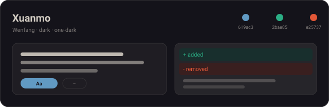
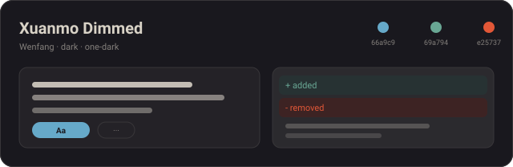
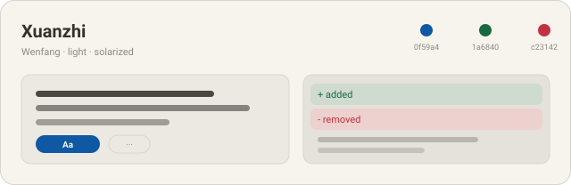
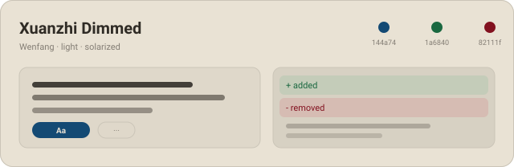
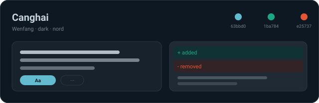
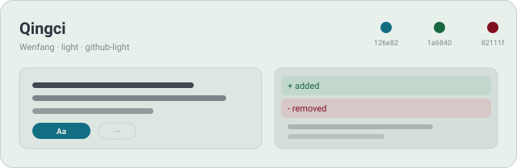

# Wenfang · 文房六色

中文 · [English](README.md)

一套面向 Coding Agent 的中式美学配色：墨、纸、海、瓷六种气质，深浅各半。
同一份设计源同时生成 **Codex** 的 `codex-theme-v1:…` 导入行与 **DeepSeek Harness** 主题插件。

## 六种配色

| | |
|:--:|:--:|
|  |  |
| **玄墨 · Xuanmo** — `dark`<br>松烟墨底、朱砂批注；适合夜间长时间编码。 | **玄墨 Dimmed · Xuanmo Dimmed** — `dark`<br>同一方墨，灯光再暗一档。 |
|  |  |
| **宣纸 · Xuanzhi** — `light`<br>生宣暖白、青绿设色；白天默认。 | **宣纸 Dimmed · Xuanzhi Dimmed** — `light`<br>陈纸暖灰、墨色更深；低眩光阅读。 |
|  |  |
| **沧海 · Canghai** — `dark`<br>深海暮色、青绿矿物。 | **青瓷 · Qingci** — `light`<br>月白釉底、青灰题字。 |

## 在 Codex 中使用

1. 从 [`dist/codex/`](dist/codex/) 复制对应变体的一整行，例如
   [`dist/codex/xuanmo.txt`](dist/codex/xuanmo.txt)。
2. Codex → **Settings → Appearance** → 按上表选择 **Dark** 或 **Light** → **Import**。
3. 粘贴整行（必须含 `codex-theme-v1:` 前缀，不要带代码围栏）。
   `codeThemeId` 必须是 Codex 内置语法主题 id，自定义 id 会让 Import 按钮灰掉。

| 变体 | 模式 | 文件 |
| --- | --- | --- |
| 玄墨 | Dark | [`dist/codex/xuanmo.txt`](dist/codex/xuanmo.txt) |
| 玄墨 Dimmed | Dark | [`dist/codex/xuanmo-dimmed.txt`](dist/codex/xuanmo-dimmed.txt) |
| 宣纸 | Light | [`dist/codex/xuanzhi.txt`](dist/codex/xuanzhi.txt) |
| 宣纸 Dimmed | Light | [`dist/codex/xuanzhi-dimmed.txt`](dist/codex/xuanzhi-dimmed.txt) |
| 沧海 | Dark | [`dist/codex/canghai.txt`](dist/codex/canghai.txt) |
| 青瓷 | Light | [`dist/codex/qingci.txt`](dist/codex/qingci.txt) |

## 在 DeepSeek Harness 中使用

一个包注册全部六套配色（`wenfang-xuanmo` … `wenfang-qingci`）：

```sh
dsh plugin --profile web add github:zhangcaiqian/wenfang-themes#path:/packages/dsh
# 发布到 npm 之后也可以：
# dsh plugin --profile web add wenfang-themes
```

重启 DSH（或刷新页面），打开 **设置 → 插件市场 → 主题 → 已注册调色板**，选一套即可。
切换即时生效，选择跨刷新保留；首次安装会按当前明暗自适应最近的一套。

## 工程

- [`themes/wenfang.json`](themes/wenfang.json) — 唯一真源：每个变体 5 个手调颜色 +
  Codex 语法主题 id 与 contrast。
- [`scripts/lib/codex.mjs`](scripts/lib/codex.mjs) — 生成六条 Codex 导入行；
  [`fixtures/codex/`](fixtures/codex/) 逐字节锁死输出。
- [`scripts/lib/dsh.mjs`](scripts/lib/dsh.mjs) — 每个变体推导约 30 个 `--dsw-*` token
  （表面层级、边框、文字层级、diff、选区、菜单）。
- [`scripts/lib/swatch.mjs`](scripts/lib/swatch.mjs) — 上面的预览图。

```sh
node scripts/build.mjs        # 重新生成全部产物
node scripts/check.mjs        # 结构 + Codex 回归 + 预览图 + WCAG 报告
node scripts/test-client.mjs  # DSH bundle：注册 / 恢复 / 不抢占内置主题
```

## 后续

计划补 Claude Code、Gemini CLI、opencode 适配器；每个适配器只是 `scripts/lib` 下的一个
emitter 加一份 golden，不需要新建仓库。

## 致谢

色板灵感致敬 [Inkstone · 墨观](https://inkstone.konata9.cc/zh/)（见 [NOTICE](NOTICE)）。
Wenfang 是独立系列名，非该站点官方主题包。代码 MIT，见 [LICENSE](LICENSE)。
